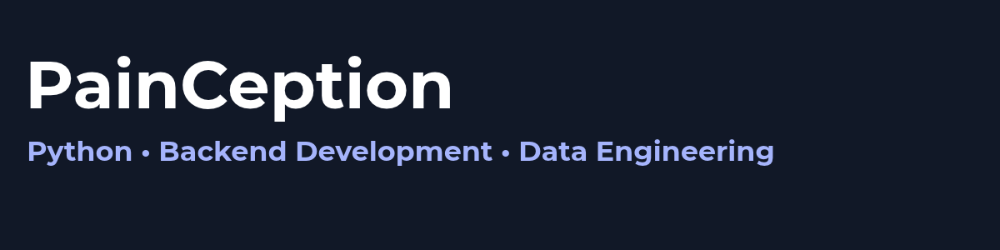

## Hi there! 👋

I'm a Python developer based in Finland, currently focused on **backend development** and working toward a career in **Data Engineering**.

I enjoy problem-solving, building practical applications, and understanding how software works under the hood.

### 🛠️ Tech Stack
- **Languages:** Python, SQL
- **Backend:** Flask, REST APIs, Authentication
- **Databases:** SQLite
- **Tools:** Git, GitHub, VS Code, pytest
- **Other:** Pygame, JWT, JSON

### 📚 Education
- Completed the University of Helsinki's **Introduction to Programming** and **Advanced Course in Programming** (Python).

### 🎯 Currently Exploring
- Backend architecture, database design, and Data Engineering.

#### 👨‍💻 Solo Projects

| Project | Description | Technologies | Status | Link |
|---|---|---|---|---|
| **Task Manager API** | REST API with JWT authentication, password hashing, and SQLite integration | Python, Flask, SQLite | ✅ Complete | [View Code](https://github.com/PainCeption/flask-task-manager-api) |
| **Python Game** | 2D game featuring enemy AI, collision detection, and dynamic hazards | Python, Pygame | ✅ Complete | [View Code](https://github.com/PainCeption/Robot-escape) |

#### 🤝 Collaborative Projects

| Project | Description | Technologies | Status | Link |
|---|---|---|---|---|
| **Reservation Calendar** | Full-stack reservation system; responsible for backend development | Flask, SQLite, React | 🚧 In Progress | [View Code](https://github.com/PainCeption/reservation-calendar) |
